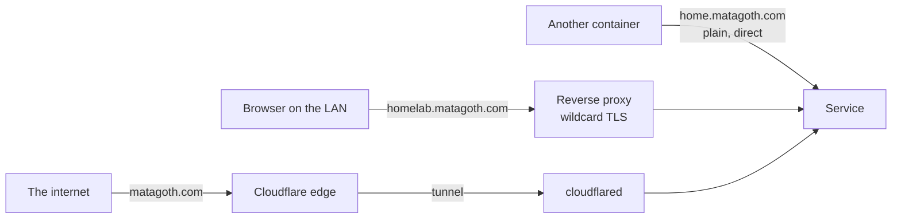
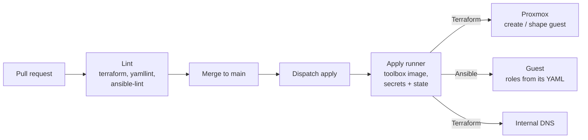

<h1 align="center">homelab</h1>

  <strong>One Proxmox box, a couple of dozen guests, and a rule that nothing gets clicked into existence.</strong>

  

  <a href="docs/ARCHITECTURE.md">Architecture</a> ·
  <a href="docs/runbooks/add-service.md">Add a service</a> ·
  <a href="docs/runbooks/troubleshooting.md">Troubleshooting</a>

---

This is the infrastructure-as-code for @wiktordepina's home server: DNS, a reverse proxy,
media, home automation, metrics, a self-hosted forge, and a growing corner of AI agents. Every
service lives in its own container, every container is one YAML file named after its ID, and
Terraform and Ansible do the rest from a runner that never leaves the box.

It started as years of hand-configured services and became code so that the system could be
read, audited and rebuilt. It's not a template and it's not trying to be. It's one person's
setup, written down honestly.

## The metal

| | |
|---|---|
| **Hypervisor** | Supermicro H11SSL-C with an AMD EPYC 7551P (32 cores, 64 threads) and 256 GB of RAM, running Proxmox VE |
| **Storage** | `zpool`: seven 8 TB drives in RAID-Z1 with an SSD log device. Proxmox itself boots from a 1 TB NVMe |
| **GPU** | NVIDIA Quadro P2000, shared into containers for media transcoding |
| **Router** | Protectli Vault V1410 running OPNsense, terminating the VLANs |
| **Switch** | TP-Link TL-SG2008P, PoE for the access point |
| **Out on the edge** | A Raspberry Pi 4B, for work that needs hardware the server can't offer |

## The estate

Principle one says a guest's VMID *is* its identity: it fixes the address (`10.20.1.<vmid>`),
the DNS name, the config file and the command that targets it. So the ID ranges double as a map.

| Range | What lives there | For example |
|---|---|---|
| `100–199` | Infrastructure everything else leans on | Pi-hole, the reverse proxy |
| `200–499` | Applications, the reason the box exists | Jellyfin, Home Assistant, Forgejo, Prometheus, n8n |
| `500–599` | CI runners for other repositories, holding no credentials | Forgejo Actions runners |
| `600–699` | Apply runners, the only place secrets and state exist | The runner that applies this repo |

Most guests are LXC containers. A few are full VMs where a container won't do, and a
handful of external hosts sit outside Proxmox entirely, configured through a thinner path.

## Three ways in

Each path into a service answers a different question, so each gets its own zone and its own
TLS story.

The proxied names come from one file, `config/services.yaml`, which also feeds the DNS records
and the index dashboard, so a service can't end up in one and missing from the others. Public
exposure is opt-in and rare, and it's the one route table still set by hand.

## The life of a change

Nothing mutating runs from a laptop. A laptop can lint and read; only the apply runner can
apply, because only the apply runner holds the secrets and the Terraform state.

A new service touches several layers at once (the guest, its roles, DNS, the proxy, the
dashboard, monitoring, the workflow). The [add-service runbook](docs/runbooks/add-service.md)
walks through every one.

## The five pillars

They don't change, and every other decision hangs off them.

1. **VMID is identity.** Knowing the number tells you everything else, without looking anything up.
   Break the mapping and DNS, monitoring and SSH all quietly point at the wrong thing.
2. **The runner is the only execution surface.** Secrets and state never leave the host. That
   one decision is why there's no "just apply it from my machine" shortcut, and why there doesn't
   need to be.
3. **Lockstep additions.** All the layers or none of them. A service that resolves but isn't
   proxied, or is proxied but not monitored, is half-deployed, and half-deployed counts as not done.
4. **One YAML per container.** Resources, mounts, roles and role variables all sit in one file
   named after the VMID. If you want to know what a container is, there's one place to look.
5. **IaC for everything except public exposure.** The Cloudflare Tunnel route table is still set
   by hand. It's written down as debt rather than hidden.

## Learnt the hard way

Some of the documentation exists because something broke first.

- **A secret has to be world-readable.** The runner is an unprivileged container, so a `0600`
  file shows up as unreadable and fails exactly like a missing one. See the
  [runner toolbox](docs/reference/runner-toolbox.md#what-the-runtime-expects).
- **Half the web needs WebSockets.** Plenty of UIs look fine behind a basic proxy and only
  freeze once you use them. The proxy now forwards upgrades for everyone, not as an opt-in.
  See [the reverse proxy](docs/concepts/reverse-proxy.md#the-websocket-class-footgun).
- **CI runners get the internet by name, not by default.** Forge jobs only reach out through a
  squid allowlist, and the firewall drops anything that tries to go round it. See
  [troubleshooting](docs/runbooks/troubleshooting.md#a-forge-ci-job-cannot-download-something).
- **An apply runner can't converge itself.** A job reshaping its own runner can restart it
  mid-apply, so apply runners come from a bootstrap and the normal path refuses their range.
  See [the runner model](docs/concepts/runner-model.md#where-apply-runners-come-from).

## What this isn't

It isn't a Kubernetes cluster, a multi-tenant platform or a turnkey homelab template. It's
deliberately one host and one owner. If you're borrowing ideas, and you're welcome to, treat
the decisions here as choices made for one person's needs, not as recommendations.

## Where to read next

Start with [docs/ARCHITECTURE.md](docs/ARCHITECTURE.md). It sets out the model and indexes the
rest: **concepts** for the *why*, **reference** for the *shape*, and **runbooks** for the *how*.

---

Nosgoth had nine pillars. This place gets by on five.

